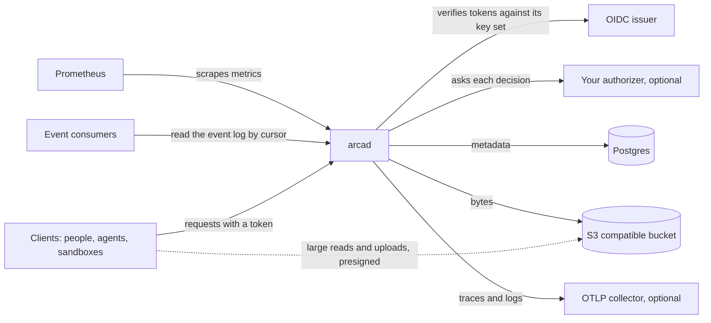

# Arca

**Durable storage for people, agents, and sandboxes.** Files and folders
with versions and trash, shares and public links, usage per space, and an
event log, over any S3 compatible bucket and a Postgres database. Identity
comes from any OpenID Connect issuer. Permission comes from an endpoint you
write, or from a built-in owner policy when you write none.

This repository is the whole service: anyone with a bucket, a Postgres
database, and an issuer can run it.

[](https://github.com/latere-ai/arca/actions/workflows/verify.yml)
[](https://github.com/latere-ai/arca/releases)
[](go.mod)
[](LICENSE)

## Status

Arca is before 1.0: a minor release may remove a field, with a
[changelog](CHANGELOG.md) entry that names the break, and
[what a version number promises](docs/operations.md#what-a-version-number-promises)
says the rest. The [releases](https://github.com/latere-ai/arca/releases)
carry the signed images and the manifests.

Everything under [What you get](#what-you-get) is served today; none of it
is only designed. Arca has had no external security audit. The
[security policy](SECURITY.md#what-is-protected) names the test behind
each commitment it makes.

## The problem

A platform that runs agents and sandboxes needs a place for what is
neither a commit nor a sandbox's local disk: the file a person uploads,
the artifact an agent produces, the working tree a sandbox needs back
tomorrow. A git host holds commits. A sandbox's volume dies with the
sandbox. An object store holds bytes but knows nothing about who owns
them, who may read them, how much a space holds, or what happened to
them last week.

Arca is that place. It gives every principal a space, every file a version
history and a trash, every share a permission, every space a usage count,
and every change an event a consumer can tail.

## Quickstart

You need Go 1.27 or newer, `git`, `curl`, and Docker or Podman with
Compose.

```sh
git clone https://github.com/latere-ai/arca.git && cd arca
mkdir -p out && make run > out/run.log 2>&1 &
until grep -q '^export ARCA_URL' out/run.log; do sleep 2; done
grep -A2 '^export ARCA_URL' out/run.log | sh
```

`make run` builds `arcad`, starts Postgres and MinIO with a bucket,
starts a stub issuer and a stub authorizer, applies the database
migrations, and starts the server. Once it is ready, it checks itself,
one line per requirement, and prints a token and two requests, which the
last line runs. The first writes an object to your own space and the
second reads it back:

```
{"path":"files/hello.txt","size":11,"checksum":"b187b04f...","checksum_kind":"sha256","content_type":"text/plain","is_public":false,"modified":"..."}
hello, arca
```

`kill %1` stops the server and the stubs, and `make clean` removes the
stack, its data and `out/`. Ports derive from the checkout's directory
name, so two clones run side by side, and everything listens on
loopback. [Running it locally](docs/local.md) is the same, step by step,
with more requests.

## How it fits



- **Clients** call the API with a token from an issuer you list. The
  server handles metadata, authorization, and small objects; a large read
  or upload goes between the client and the bucket over a presigned URL.
- **Event consumers** tail each space's event log, rather than receiving
  webhooks.
- **The bucket** holds the bytes and **Postgres** holds what they mean:
  owners, paths, versions, shares, usage, and events.
- **Prometheus** scrapes the metrics, and an **OTLP collector**, when you
  run one, receives a span per request and the log records beside it.

Arca verifies and asks. Every request carries a token from an issuer you
list; Arca checks it against the issuer's key set and reads nothing else
from the issuer. Whether the caller may act is a question Arca sends,
with the verified claims and the action, to an
[authorization endpoint](docs/authorizer.md) you write. Without one, the owner policy applies: a subject acts on its own
space, the administrators you list act on every space, and anyone else
gets what a grant or a link gives them.

The contract is shared with [Origo](https://github.com/latere-ai/origo),
[Cella](https://github.com/latere-ai/cella), and
[Lux](https://github.com/latere-ai/lux), so one endpoint can answer for
all four.

## How it works

- **The bucket holds bytes, the database holds meaning.** A write goes to
  the bucket first and to the database second; a delete goes to the
  database first and to the bucket second. A failure between the two
  leaves bytes nothing points at, never a record of bytes that are gone,
  and a reconciler removes the leftovers.
- **Keys come from ids, not paths.** Every write of content gets a fresh
  id and its own key, so a move or a rename is a database update, an
  overwrite keeps the old version without copying it, and one bucket can
  hold several installations under different prefixes.
- **Bytes stay off the server.** A large read is a redirect to a
  short-lived presigned URL, and a large upload goes to the bucket in
  parts the client sends directly. The server handles metadata,
  authorization, and small objects.
- **A space is one tree.** Every path begins with `files/`, and a folder
  is a prefix: nothing is stored for it, and a folder with nothing in it
  does not exist. A folder is deleted in one call and copied in one call,
  and the bucket does the copying.
- **Arca stores no limit.** An authorizer's answer can cap what a space
  holds, keep no version of the write it admits, make the delete it admits
  permanent, and leave subtrees out of what a caller lists. Each holds for
  that answer only, and Arca keeps no list of folders with rules of their
  own.
- **Any replica serves any request.** Nothing is kept on local disk and
  there is no leader. Scale the Deployment.

## Install it for real

[`docs/install.md`](docs/install.md) goes from a Kubernetes cluster to a
serving installation. You supply four things: a bucket at any S3
compatible endpoint, a Postgres database, an OIDC issuer, and a hostname.
An authorization endpoint is optional.

## What you get

- **Files.** Put, get, head, list, move, copy, and delete, with a version
  kept on every overwrite, a trash that holds deleted files for 30 days by
  default, stars, and conditional requests on the object's checksum.
- **Folders.** Delete everything under a folder in one call, to the trash
  or for good. Copy a folder to another path of the same space without a
  byte passing through the server. Fetch one as a manifest of presigned
  URLs.
- **Uploads in parts.** An object up to 5 GiB by default goes to the
  bucket in parts over presigned URLs, and the server assembles it.
- **Shares and links.** Grant a subject `read`, `write`, or `manage` on a
  subtree of a space, or mint a link whose token lets anyone holding it
  read.
- **Limits from your authorizer.** Its answer can carry a byte limit for
  the space, turn versions or the trash off for one write or one delete,
  and leave subtrees of a shared space out of one reader's listings, so a
  folder your installation manages for its users needs no rule stored in
  Arca.
- **An event log.** Every change to a space is one event, read by cursor,
  so a consumer tails the log rather than receiving webhooks.
- **Administration.** Usage per space across the installation, and a
  restore of any space's trashed file.
- **Telemetry.** Prometheus metrics and alert rules, and, with an OTLP
  collector, one span and one duration measurement per request, the
  bucket calls as its child spans, the trace id on the response in
  `X-Trace-Id`, and the log records beside them.
- **An OpenAPI document** generated from the route table and served by
  every installation at `/openapi.json`.
- **A conformance suite** you run against your own installation, or
  against anything that claims to serve the same API.
- **Packages to build on.** `latere.ai/x/arca/object` (ids, keys, paths)
  and `latere.ai/x/arca/authorizer` (the action vocabulary an
  authorization endpoint is written against).

## Documentation

| | |
|---|---|
| [Running it locally](docs/local.md) | the server and everything it needs on one machine, from a clone, with requests that show it working |
| [Install](docs/install.md) | from a cluster, a bucket, and a database to a serving installation |
| [Configuration](docs/configuration.md) | every environment variable with its default |
| [API](docs/api.md) | the model, every route, lists, conditional requests, errors, and limits |
| [Authorizer](docs/authorizer.md) | the question Arca asks the endpoint you write, the actions, the answer and the limits it may carry, and the policy without one |
| [Security](docs/security.md) | what Arca guarantees, what it sees and keeps, what it does not defend, and what an operator keeps safe |
| [Operations](docs/operations.md) | checking an installation, upgrades and rollbacks, verifying a release, monitoring |

[`docs/README.md`](docs/README.md) is the index.
[`docs/internals/`](docs/internals/README.md) explains how Arca is built,
for people changing it, and the design records behind each decision are
in [`specs/`](specs/README.md).

## Contributing

Issues and pull requests are welcome. [`CONTRIBUTING.md`](CONTRIBUTING.md)
covers the quality gate, the test tiers, and how a change is reviewed.
[`SECURITY.md`](SECURITY.md) is how to report a vulnerability; please do
not open an issue for one.

## License

MIT. See [`LICENSE`](LICENSE).
