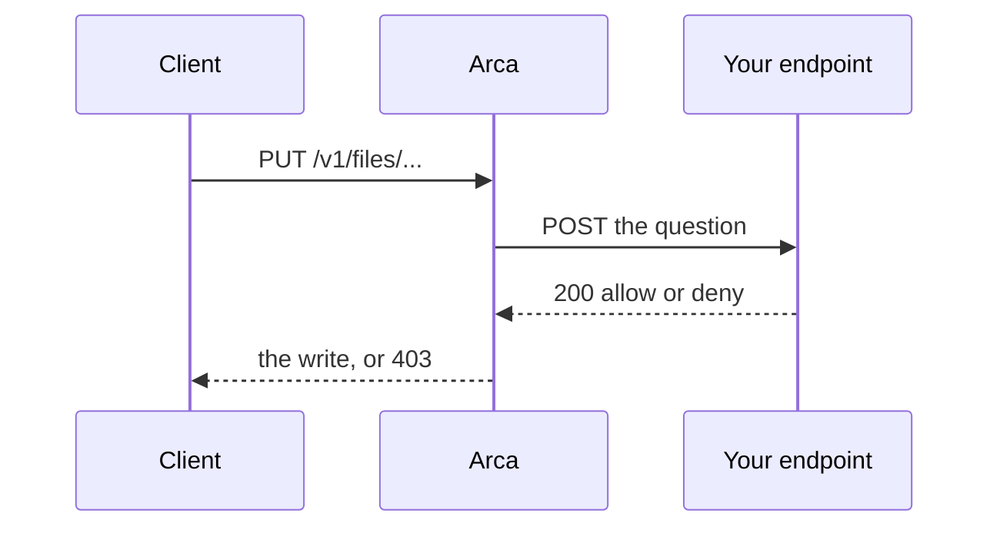

# Writing an authorizer

For whoever writes the endpoint `ARCA_AUTHORIZER_URL` points at. Arca stores
the bytes and keeps the grants. Everything else about who may do what is
yours: a plan, a team, a quota, a role, which folders belong to a program
rather than a person. Before every action Arca sends one question to your
endpoint and follows its answer. This page is the contract.

The contract is shared with [Origo](https://github.com/latere-ai/origo),
[Cella](https://github.com/latere-ai/cella), and
[Lux](https://github.com/latere-ai/lux), so one endpoint can answer for all
four behind one bearer. Without an endpoint, Arca decides by the
[built-in owner policy](#without-an-authorizer).



## The question

Before every action, Arca sends one request to `ARCA_AUTHORIZER_URL`,
presenting `ARCA_AUTHORIZER_TOKEN` as the bearer. The
[configuration](configuration.md#identity-and-authorization) page says how to
set both.

```
POST <ARCA_AUTHORIZER_URL>
Authorization: Bearer <ARCA_AUTHORIZER_TOKEN>
Content-Type: application/json
Accept: application/json
```

```json
{
  "subject":  "https://issuer.example|9ab3",
  "issuer":   "https://issuer.example",
  "sub":      "9ab3",
  "claims":   {"iss": "https://issuer.example", "sub": "9ab3", "aud": "arca", "exp": 1793982589},
  "action":   "file.write",
  "resource": {"kind": "File", "owner": "https://issuer.example|9ab3",
               "path": "files/reports/q3.pdf", "plane": "files", "size": 48213},
  "request":  {"id": "req_01J8R4...", "ip": "203.0.113.4", "user_agent": "curl/8.7"}
}
```

- `subject` is the issuer and the `sub` joined by `|`, and `issuer` and `sub`
  are its two halves. `subject` is empty for an anonymous request, which only
  the link routes make.
- `claims` is every verified claim of the token, as it arrived. Arca reads
  none of them itself, so a plan, a team, or a role is read here.
- `action` is one of [the vocabulary](#the-vocabulary).
- `resource` is one flat object: its `kind`, its `id` when it has one, and the
  fields of that kind. A field Arca does not know for a question is left out
  rather than sent empty.
- `request` is the request's id, the caller's address, and its user agent. The
  id is for correlating logs.

Arca waits 5 seconds for an answer, the retry included. It asks once more when
the connection failed before any response began, such as a refused or reset
connection, and never after a response line arrived.

## The vocabulary

Sixteen actions over six kinds. In Go, import `latere.ai/x/arca/authorizer`
for the action names and resource shapes rather than copying the strings from
this page.

| Kind | Actions | Fields |
|---|---|---|
| `File` | `file.read`, `file.write`, `file.delete`, `file.list`, `file.restore` | `owner`, `path`, `plane`, `size`, `from`, `recursive`, `copy`, `grant`, `grants`, `grants_truncated` |
| `Upload` | `upload.write` | `owner`, `path`, `size`, `grant`, `grants`, `grants_truncated` |
| `Share` | `share.create`, `share.read`, `share.list`, `share.revoke` | `owner`, `path`, `grantee`, `permission` |
| `Link` | `link.create`, `link.read`, `link.revoke` | `owner`, `path` |
| `Event` | `event.read` | `owner` |
| `Space` | `space.admin`, `space.delete` | `owner`, absent on the overview across spaces |

Each action, with the routes that ask it. Every route's row in the
[API guide](api.md) names its action.

| Action | Asked by |
|---|---|
| `file.read` | `GET` and `HEAD` of one object, of a version, and of a version listing |
| `file.write` | `PUT` of an object, `POST` with `move_to`, `copy_to`, or `restore_version` on a path, and starring and unstarring |
| `file.delete` | `DELETE` of an object, a version, or a folder, and `DELETE /v1/trash` |
| `file.list` | every listing, a search, a manifest, `GET /v1/trash`, and `GET /v1/stars` |
| `file.restore` | `POST /v1/trash/restore`, and `restore_version` when it brings a version forward |
| `upload.write` | opening, completing, and aborting an upload session |
| `share.create` | `POST /v1/shares` |
| `share.read` | `GET /v1/shares/{id}` |
| `share.list` | `GET /v1/shares` and `GET /v1/shares/with-me` |
| `share.revoke` | `DELETE /v1/shares/{id}` |
| `link.create` | `POST /v1/shares/links` |
| `link.read` | `GET /v1/shares/links`, and the routes under `/v1/shares/links/{token}`, which carry no bearer |
| `link.revoke` | `DELETE /v1/shares/links/{id}` |
| `event.read` | `GET /v1/events` |
| `space.admin` | `GET /v1/admin/overview` and `POST /v1/admin/spaces/{owner}/restore` |
| `space.delete` | `DELETE /v1/admin/spaces/{owner}` |

Four fields of a `File` say what kind of act the question is about:

| Field | Present on | Meaning |
|---|---|---|
| `plane` | every `File` question that names a path | always `files`. A space is one tree; the member stays so that an endpoint that reads it keeps working |
| `from` | a move and a copy | the source path. `path` is then the destination |
| `copy` | a copy, as `true` | `from` is read and stays where it is. A question that carries `from` without `copy` is a move |
| `recursive` | a folder delete and a folder copy, as `true` | `path`, and `from` where there is one, name a folder and everything under it |

`recursive` and `copy` are absent unless true. A question about a folder
carries no `id`. A folder delete carries no `size`, and a copy's `size` is
the sum of the bytes it would write, counted before the answer. An endpoint
that knows neither member answers a folder delete as a delete of one path
and a copy as a move, which is never wider than what was asked. An endpoint
that manages folders of its own needs `recursive`: a delete of a folder is
a delete of every folder under it.

`grant` is the rung the caller holds on the resource through Arca's own
grants table, `read`, `write`, or `manage`, and is absent when it holds none.
On a question that carries `from`, a move or a copy, it is the lower of the
rungs the caller holds on `path` and on `from`, so a grant that covers one
end and not the other gives none. An endpoint that honors Arca's grants
reads it; one that keeps its own permissions ignores it.

`grants` is the rung of everyone who holds one on the resource, for an
endpoint that decides a question as somebody other than the caller, such
as an agent's request decided as the person the agent acts for. `grant`
cannot serve it: it is the caller's, and Arca reads no claim, so it does
not know whom the endpoint decides as. `grants` lists each subject that
holds a grant on the path, with the highest rung it holds there, sorted
by subject:

```json
"grants": [
  {"subject": "https://issuer.example|4c1d", "permission": "read"},
  {"subject": "https://issuer.example|7e20", "permission": "write"}
]
```

On a move or a copy a subject is listed only when it holds a rung on both
`path` and `from`, with the lower of the two. A link is never listed: it
names no subject. The list holds at most 64 entries, the first 64 by
subject, and a question about a path more subjects hold a grant on also
carries `"grants_truncated": true`. A subject missing from a truncated
list may still hold a rung, so an endpoint that does not find the subject
it decides as in a truncated list refuses the question rather than read it
as holding none.

`grants` is sent on every `File` and `Upload` question about a path in a
space that is not the caller's own, as an empty list when nobody holds a
grant there. It is absent on a question about the caller's own space, on an
anonymous one, and from a release of Arca before it was added, so an
endpoint tells "nobody holds a grant" from "this question does not say".

## The answer

The answer is `200` either way:

```
200 {"allow": true, "ttl": 60, "limits": {"quota_bytes": 53687091200}}
200 {"allow": true, "ttl": 300, "limits": {"versions": false, "trash": false}}
200 {"allow": true, "ttl": 60, "limits": {"omit": ["files/team/payroll", "files/agents/7c1e"]}}
200 {"allow": true, "filter": {"owners": ["https://issuer.example|9ab3"]}}
200 {"allow": false, "reason": "not a member"}
```

| Field | Meaning |
|---|---|
| `allow` | required; the decision |
| `reason` | on a deny, a short reason for the log. It reaches the caller as developer detail on the error, never in its message |
| `ttl` | seconds Arca may reuse an allow for the same question; 60 when absent, at most 600. A deny is reused for 5 seconds. A question about a resource with no id, such as a create, is never reused |
| `limits.quota_bytes` | the most the space may hold; a write past it is `413 quota_exceeded`. Absent means no limit |
| `limits.versions` | `false`: the write this answer admits keeps no version of the content it replaces. Read on the answer to `file.write`, to `upload.write`, and to `file.restore` when it brings a version forward. Absent or `true`: a version is kept |
| `limits.trash` | `false`: the delete this answer admits is permanent, exactly as `?permanent=1` is. Read on the answer to `file.delete`. Absent or `true`: the delete goes to the trash |
| `limits.omit` | a list of path prefixes of the space, read on the answer to a question that enumerates. The enumeration leaves out every path at or under one of them. Absent or empty: nothing is left out. [Its whole rule](#leaving-subtrees-out-of-an-enumeration) is below |
| `filter` | on a `list` action, narrows the page to the named `owners`; a list outside the filter is an empty page, not a `403` |

A deny on the action a request asked is `403 forbidden`. A deny on a lookup of
an object another request named is `404 not_found`, the same answer as one
that does not exist, so a refusal never reveals that something is there.

### What an answer may limit

Arca stores no limit. An answer's `limits` object holds for that answer's
`ttl` and for the question it answered, and an answer without one limits
nothing. An installation that keeps folders of its own in its users'
spaces, such as the output of a program it runs for them, decides who
writes there in its endpoint and shapes the write through the answer. Arca
holds no list of such folders and reads no path for meaning.

- **A limit narrows and never widens.** No value of `limits.trash` makes a
  delete soft that asked for `?permanent=1`, no entry of `limits.omit` adds
  a row to an enumeration, and no member is read on a deny.
- **Each member is read off the answer to the request's own question.** An
  upload reads `limits.versions` off the answer to the `upload.write` its
  completing step asks, and nothing about a limit is kept with the session.
- **The object is read whole.** A member that is not the type the table
  above gives it, such as a `versions` that is not a boolean or a
  `quota_bytes` that is not a number, is the endpoint's error and is no
  decision: the request is refused with `503 storage_unavailable`, nothing
  is written, and no member of that answer is applied. A member Arca does
  not know is not read, so an endpoint may send members for a newer server.
- **`limits.versions: false` is about the write, not the path.** The
  content the write replaces is dropped once nothing else names its bytes,
  and the space is charged the difference in size. Versions the path
  already has are untouched. A version brought forward under it becomes the
  current content, and the content it replaces is dropped, not kept as a
  version.
- **`limits.trash: false` removes what `?permanent=1` removes:** the
  object, its versions, and their bytes, and for a folder delete what
  [a permanent folder delete](api.md#folders) removes.
- **The built-in owner policy sends no limits.** An installation without an
  authorization endpoint keeps versions and the trash everywhere and leaves
  nothing out of an enumeration.

A limit is a switch or a list, never a number of versions to keep or a
retention of its own: `ARCA_TRASH_RETENTION` stays the installation's one
window.

### Leaving subtrees out of an enumeration

In a space several subjects may read, an endpoint answers an enumerating
question with "allowed, but leave these subtrees out", and `limits.omit` is
that answer.

| Rule | Value |
|---|---|
| The member | `limits.omit`, a JSON array of strings, read on the answer to a question that enumerates. Absent, `null`, or empty leaves nothing out |
| An entry | a path prefix of the space, in the shape a path has: it begins with `files/` and names at least one segment under it, with no leading or trailing slash, no empty segment, no `.` or `..`, and no control character. `files` on its own is not an entry: an endpoint that leaves everything out denies the question |
| What an entry covers | the path equal to it and every path under it, matched on whole segments. `files/team/pay` covers `files/team/pay` and `files/team/pay/may.pdf` and does not cover `files/team/payroll` |
| An answer Arca cannot read | an `omit` that is not an array of strings, or an entry that is not in the shape above, is the endpoint's error and is no decision: `503 storage_unavailable`, with nothing listed and nothing written. It is never ignored and never applied in part |
| Where it is applied | in the query. A page is as full as the rows the caller may enumerate allow, a count counts only those rows, and a cursor is the position of a row the caller read |
| What it does not shape | a question about one object or one folder. Each is its own question to the endpoint, which allows or refuses it, and Arca stores nothing from one answer to apply to the next |
| Usage | a space's usage stays the whole space's: the `space` object of a root listing, each row of the administrative overview, and what a write is charged against `limits.quota_bytes`. It is the counter the space is charged against, so it is not narrowed |
| The built-in owner policy | sends no `omit` |

One example. The answer to `file.list` for `files/team` carries
`"omit": ["files/team/payroll"]`. The listing of `files/team` then holds
no entry under `files/team/payroll` and does not synthesize that folder.
`GET /v1/files/{owner}/files/team/payroll/may.pdf` is not that question:
it asks `file.read` for that path, and the caller reads the object or is
refused by that answer alone. `GET
/v1/files/{owner}/files/team/payroll?list=1` asks `file.list` for that
folder, and its page is shaped by what that answer's own `limits.omit`
holds and by nothing an earlier answer said.

Every route that returns the path, the name, a count, or the bytes of
anything other than the one object asked for honors the member:

| Route | Answer it is read on | What an entry leaves out |
|---|---|---|
| `GET /v1/files/{owner}/{path}?list=1` | `file.list` | every entry it covers, and a folder in `prefixes` that holds nothing else. The listing is deep, one page of every object under the prefix, so one rule serves the listing of a folder and of every folder above it. A search with `?q=` and a page with `?recent=1` leave out the same entries |
| `GET /v1/files/materialize` | `file.list` | the files of the manifest it covers |
| `GET /v1/trash` | `file.list` | the trashed entries it covers |
| `DELETE /v1/trash` without `path` | `file.delete` | the trashed entries it covers stay in the trash and out of `purged` |
| `GET /v1/stars` | `file.list` | the stars it covers. The page crosses spaces (below) |
| `DELETE /v1/files/{owner}/{path}?recursive=1` | `file.delete` | the objects it covers are neither trashed nor removed, with their versions. A grant or a link at, under, or above an omitted subtree of the folder stays. The event's counts leave them out, and the call is still `204` |
| `POST /v1/files/{owner}/{path}` with `copy_to` and `recursive` | `file.write` | an object is not copied when an entry covers its source path or its destination path, and `files` and `bytes` leave it out. A folder all of whose objects are left out is `404 not_found`, as a folder with nothing under it is |
| `POST /v1/files/{owner}/{path}` with `move_to` and `recursive` | `file.write` | the same as for the copy: an object is not moved when an entry covers its source path or its destination path, nothing is written under an omitted destination, and a grant or a link at, under, or above an omitted subtree stays |
| `GET /v1/events` | `event.read` | an event whose `path`, or whose `detail.from`, it covers. Both ends of a move and of a copy are read. `next_cursor` is the id of a row the caller read, so the next page passes over every omitted row after it |
| `GET /v1/shares` | `share.list` | a grant whose `path_prefix` it covers. A grant on a prefix above an omitted subtree is listed |
| `GET /v1/shares/with-me` | `share.list` | the same. The page crosses spaces (below) |
| `GET /v1/shares/links` | `link.read` | a link whose `path_prefix` it covers |
| `GET /v1/shares/links/{token}` | `link.read` | the entries of the link's listing it covers |

Not shaped, each for the reason beside it:

| Route | Why |
|---|---|
| `GET` and `HEAD` on a path, `?version=N`, `?versions=1` | one object. The version listing names one path and cannot span two |
| `PUT` on a path, `POST` with `move_to` or `copy_to` without `recursive`, or with `restore_version` | one object, named by the request |
| `DELETE` of one path, `?version=N`, `DELETE /v1/trash?path=`, `POST /v1/trash/restore`, `PUT` and `DELETE /v1/stars` | one object, named by the request |
| `POST /v1/uploads`, its complete and its abort | one session. No route lists sessions |
| `POST /v1/shares`, `GET` and `DELETE /v1/shares/{id}`, `POST /v1/shares/links`, `DELETE /v1/shares/links/{id}` | one grant or one link |
| `GET /v1/shares/links/{token}/meta`, `GET /v1/shares/links/{token}/files/{path}` | the link itself, and one object under it |
| `GET /v1/admin/overview` | usage per space, which stays the whole space's |
| `POST /v1/admin/spaces/{owner}/restore` | one id |
| the routes at the origin root | no space |

There is no search route.

**Two pages cross spaces.** `GET /v1/stars` and `GET /v1/shares/with-me`
ask one question that names the caller, and their rows are in every space
the answer's `filter` admits. One answer carries one list, so an entry
leaves out the matching path in every space on the page. An endpoint that
has to tell two spaces apart on these two pages narrows by `filter.owners`.
An entry scoped to one space is not offered.

## Failing closed

An answer Arca cannot use is a refusal, and the client sees
`503 authorizer_unavailable`. There is no fail-open. Rules an endpoint must
keep:

1. **Answer 200 for both verdicts.** Anything else, a 5xx, a timeout after
   five seconds, an answer longer than 64 KiB, or a body without `allow`, is
   a refusal. Nothing is changed by a request the endpoint did not allow, and
   the client may retry.
2. **Deny the probe.** The resource id
   `00000000-0000-0000-0000-000000000001` is reserved: deny it for every
   subject and every action. It is sent as a `Space` resource under
   `space.admin`. `arcad check` and `/readyz` send it and fail when the
   endpoint allows it, because such an endpoint is not reading the request
   and would allow every action Arca adds later.
3. **Treat its availability as Arca's.** Every request waits on it. Run it
   near the replicas and answer from memory.

What Arca keeps is an answer to a complete question: an allow for its `ttl`
and a deny for 5 seconds, each keyed on everything in the question except
`request.id`. A limit is held while the answer that carried it is held. An
answer that failed is never kept, so a recovered endpoint is asked again on
the next request.

## Without an authorizer

With `ARCA_AUTHORIZER_URL` unset, Arca decides by the built-in owner policy,
in process:

- A subject acts on its own space.
- The subjects in `ARCA_ADMIN_SUBJECTS` act on every space. The
  [configuration](configuration.md#identity-and-authorization) page says how to
  write them.
- Anyone else gets what a [grant](api.md#shares-and-links) gives them, up to
  the rung the action needs: `read`, `write`, or `manage`. A move or a copy
  needs that rung on both paths.
- A link holder may read what a live link names.
- The probe is denied for everyone, and everything else is refused.

The policy sends no `limits` and no `filter`. It is the right choice for a
single team. Run an authorizer when who may see what is a decision your
product makes rather than a property of storage.

## A token's own grants

A token minted from a stored key, one whose `token_use` claim is `pat` (a
personal access token) or `sak` (a service account key), may do only what its
grants name: RFC 9396 `authorization_details` entries of type `latere-authz`,
each naming actions as `arca:<action>`, for example `arca:file.read`, and
optionally one resource id. The owner policy applies them: a request no grant
of such a token covers is refused, whatever the policy would allow, and a
grant never allows what the policy refuses. Other tokens are decided by the
policy alone.

Arca forwards the token's claims untouched, so an endpoint reads the same
grants from `claims`. One written with
[`latere.ai/x/pkg/authz/server`](https://pkg.go.dev/latere.ai/x/pkg/authz/server)
applies them the same way.

## Writing one

Any HTTP server that answers the question works. In Go:

- [`latere.ai/x/arca/authorizer`](https://pkg.go.dev/latere.ai/x/arca/authorizer)
  declares the vocabulary: the action constants, one resource type per kind,
  and `authorizer.Vocabulary()`.
- [`latere.ai/x/pkg/authz/server`](https://pkg.go.dev/latere.ai/x/pkg/authz/server)
  is the scaffold. It checks the bearer, decodes the question, refuses the
  probe id and an action outside the vocabulary, applies a token's grants, and
  calls your decision.
- [`latere.ai/x/pkg/authz/conformance`](https://pkg.go.dev/latere.ai/x/pkg/authz/conformance)
  is a test suite your endpoint can run against the same vocabulary.

Run `arcad check` against the endpoint before you point replicas at it. The
check passes only when the endpoint denies the probe.
