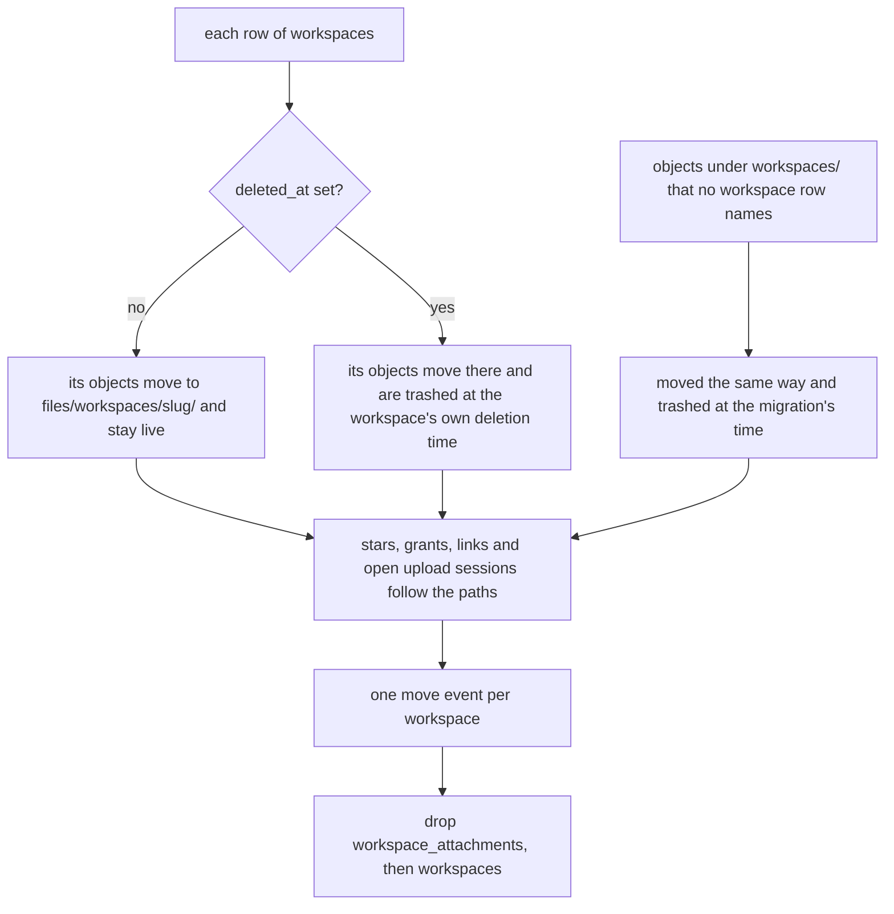
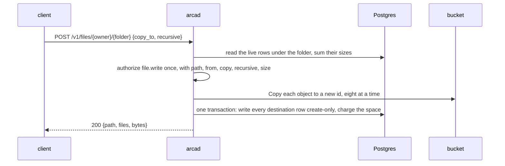

# One tree

## Overview

### Scope

A space becomes one tree. Every path of a space starts with `files/`, a
person or a program manages files and folders in it freely, and nothing
else in a space has rules of its own. This spec removes the second plane,
`workspaces/`, with everything [[009-workspaces]] built for it, moves what
that plane holds into ordinary folders, and adds what a tree needs and
Arca lacks: deleting a folder in one call, copying a folder on the server,
and two limits an authorizer's answer may carry so that a subtree an
installation manages keeps no version history and no trash.

### Problem

[[009-workspaces]] gave a space a second plane: a named subtree with a
writer lease, attached by a sandbox, materialized into it and synced back.
The protocol came from the service Arca replaces and was shaped for one
client, `latere.ai/x/pkg/drive`. No repository imports that client today,
and no caller known to this repository asks for an attach, a renew, a
materialize of an attachment, a sync or a release. What is still called is
the record: create, list, rename, delete, restore.

The plane costs more than the twelve routes. Every handler of
[[005-files]] branches on it: a delete is soft in one plane and hard in
the other, an overwrite keeps a version in one and not in the other, a
move is refused in one, and every path under `workspaces/` pays a lookup
of its workspace before it is read. Two of those rules are useful to any
installation that manages a subtree for its users, and today the only way
to get them is to put the subtree in the other plane with a lease nobody
holds.

Two operations are missing for a tree that people and programs manage. A
folder is deleted one object at a time, so removing a tree for good takes
as many calls as it has files and stops half way when one fails. A folder
is copied by reading every byte out and writing it back.

### What an installation gets

Arca stays generic. It asks its authorizer about every action, as
[[006-identity]] says, and reads no path for meaning. An installation that
keeps folders of its own in its users' spaces, such as the output of a
program it runs for them, decides who writes there in its authorizer and
shapes the write through the answer's limits, the way `limits.quota_bytes`
already shapes a space. Arca holds no list of such folders.

## Design

### One plane

| Rule | Before | After |
|---|---|---|
| The first segment of a path | `files` or `workspaces` | `files` |
| A path under `workspaces/` | read and written under spec 009's rules | `400` `unknown_plane`, as any path outside a plane is |
| `object.Plane` | `PlaneFiles`, `PlaneWorkspaces` | `PlaneFiles`; `PlaneWorkspaces` is removed from the package |
| `plane` on a `File` question | `files` or `workspaces` | `files`, always; the member stays, so an authorizer that reads it keeps working |
| A listing of a plane root | either root carries `space` | `GET /v1/files/{owner}/files?list=1` carries `space` |
| A delete | soft under `files/`, hard under `workspaces/` | soft, unless the request or the answer says otherwise (below) |
| An overwrite | keeps a version under `files/`, none under `workspaces/` | keeps a version, unless the answer says otherwise (below) |
| A move | refused under `workspaces/` | every path moves |
| The workspace lookup before a path is touched | on every path under `workspaces/` | gone, with the `files.Workspaces` seam |

A folder is what it was: a prefix. Arca stores no directory, a listing
synthesizes the folders below a prefix from the objects it holds, and a
folder with nothing in it does not exist. `GET /v1/files/materialize`
stays as [[013-api]] wrote it, the one call that answers a folder as a
manifest of download addresses: `?prefix=` names the folder, the answer is
`{root, files: [{path, checksum, size, url}]}`, and each address is a
presigned read of the object's own key.

### What is removed

| What | Where it lives today |
|---|---|
| the twelve routes under `/v1/workspaces` | `internal/workspaces/routes.go`, [[013-api]]'s workspace table |
| the eight actions `workspace.create`, `workspace.read`, `workspace.write`, `workspace.delete`, `workspace.list`, `workspace.attach`, `workspace.sync`, `workspace.restore`, and the kind `Workspace` with its resource | `authorizer/actions.go`, `authorizer/resources.go` |
| the rows of the owner policy that admit a grantee to a workspace action, the eight-action list no grant reaches (it becomes five), and the `workspaces/<slug>` prefix a grant on a workspace was read against | `internal/auth/policy.go`, `internal/auth/grant.go` |
| the tables `workspaces` and `workspace_attachments` | migration `0004_workspaces.up.sql`; dropped by the migration below |
| the package `internal/workspaces`, with the lease, attach, renew, release, materialize of an attachment and sync | the whole package |
| the query sets `store.Workspaces` and `store.Attachments` | `internal/store/workspaces.go` |
| the events `attach`, `release` and `sync` | `internal/events/events.go`; `restore` and `reap` stay, the first for the trash and the second for the reaper |
| reaper pass 3, expired leases, and pass 6, tombstones, with the finding kinds `workspace_purged` and `file_purged` | `internal/reaper`, `cmd/arcad` |
| the error codes `slug_taken`, `writer_held`, `lease_not_held`, `manifest_incomplete` and `attachment_gone` | `internal/api/errors.go`, [[013-api]]'s error table |
| `workspaces` and `leases` on a space's row of the overview, and the workspace arm of the restore across spaces | `internal/admin` |
| the value `workspaces` of the `plane` label | `internal/metrics` |
| invariant 7 of [[001-architecture]], one writer per workspace, and its criterion 17 | the number is retired and not reused |
| the conformance group of spec 009 | `test/conformance/cases009.go` |

The statements that drop and move a subtree in
`internal/store/workspaces_objects.go` are not removed. They are what the
folder delete below runs, and they move to the files query set.

After the removal the vocabulary is fifteen actions over six kinds, the
surface is twenty-nine routes, and the event table is nine actions: the
eight that remain and `copy`, below.

### The migration

`0006_one_tree.up.sql`, owned by this spec. Its statements commit
together or not at all.



| Step | What it does |
|---|---|
| 1. The destination | For each workspace the folder is `files/workspaces/<slug>`. Where the space already holds a row at or under that path, live or trashed, the folder is the first of `files/workspaces/<slug>-2`, `files/workspaces/<slug>-3` and so on under which the space holds none. The choice is made per workspace before any row moves, so no path collides and no row is overwritten |
| 2. The objects | Every `files` row whose path is under `workspaces/<slug>/` takes the same path under the destination. The object id, the checksum, the size and the times are untouched, so no bucket key changes (invariant 8 of [[001-architecture]]) and the usage ledger of the space is unchanged |
| 3. What keys on a path | `file_versions.path`, `stars.path`, `upload_sessions.path` and `shares.path_prefix` are rewritten by the same rule, so a bookmark, an open upload, a grant and a public link on a workspace or inside it keep pointing at the same objects |
| 4. A soft deleted workspace | Its objects are moved as in step 2 and then trashed, with `deleted_at` set to the workspace's own `deleted_at`. They are in the trash of [[005-files]] for what is left of `ARCA_TRASH_RETENTION`, restorable one object at a time, and the trash pass of [[010-events-and-reaper]] purges them when the tombstone pass would have |
| 5. Objects with no workspace | A row under `workspaces/<slug>/` that no `workspaces` row names is unreachable today. It is moved as in step 2 and trashed at the migration's time, so it is neither lost nor brought back into a listing |
| 6. The record | One `move` event per workspace in the space's log, its path the destination folder and its detail `{"from": "workspaces/<slug>", "files": <n>, "trashed": <bool>}`, with no actor. Rows already in the log under `workspaces/` are history and are left as written; log retention removes them within thirty days |
| 7. The tables | `workspace_attachments`, then `workspaces`, with their indexes |

An attachment that is active when the migration runs ends with its
table. Its holder's next call is to a route that no longer exists, and
nothing it had synced is lost, because a sync wrote ordinary objects.

Migrations in this tree are forward only ([[004-metadata-store]]), so
there is no `.down.sql`. What a rollback needs is written here so that it
is one decision and not a design: a later migration that creates the two
tables again, empty, from the text of `0004_workspaces.up.sql`. The
objects stay in `files/workspaces/`, where the earlier binary reads them
as ordinary files. Open question 1 is whether that is enough.

### The limits an answer may carry

Arca stores no limit. An answer's `limits` object holds for that answer's
`ttl` and for the question it answered, which is how `limits.quota_bytes`
works ([[006-identity]], [[010-events-and-reaper]]). Two members join it.

| Member | Read on the answer to | Meaning |
|---|---|---|
| `limits.versions` | `file.write`, `upload.write` | `false`: the write this answer admits keeps no version of the content it replaces. The replaced object's bytes are dropped after the commit, when nothing else names them, and the space is charged the difference in size. Absent or `true`: versions as [[005-files]] keeps them |
| `limits.trash` | `file.delete` | `false`: the delete this answer admits is permanent, exactly as `?permanent=1` is: the row, its versions and their bytes. Absent or `true`: the trash of [[005-files]] |

```json
200 {"allow": true, "ttl": 300, "limits": {"versions": false}}
200 {"allow": true, "ttl": 300, "limits": {"trash": false}}
```

Rules of the two:

- They narrow and never widen. No value of `limits.trash` makes a delete
  soft that asked for `?permanent=1`, and neither member is read on a
  deny.
- Each is read where the limit of bytes is read, off the answer the
  handler was given, so an upload session's completing step reads the
  answer to its own `upload.write` and no session row holds a limit.
- A member that is not a boolean does not decode, and the request is
  refused with the `503` a `limits.quota_bytes` that does not decode is
  refused with today. Nothing is written.
- Versions a path already has are untouched by a write under
  `limits.versions: false`. The limit is about the write, not the path.
- A version brought forward under `limits.versions: false` becomes the
  current content and the content it replaces is dropped, not kept as a
  version.
- The owner policy sends no limits, so an installation without an
  authorizer keeps versions and the trash everywhere.
- The two retention constants and `ARCA_TRASH_RETENTION` are unchanged.
  A numeric limit, such as a count of versions to keep, is not offered:
  the reaper's retention passes run without an answer, so they could not
  honor one.

These two members are what the workspaces plane hard-coded by prefix.
`internal/files` decides both from the plane today
(`out.Versioned = w.Plane == object.PlaneFiles && held`, and the soft
arm of `remove`), and the change is to read the answer there.

### Deleting a folder

```
DELETE /v1/files/{owner}/{path...}?recursive=1
DELETE /v1/files/{owner}/{path...}?recursive=1&permanent=1
```

`path` names a folder: the operation covers every object whose path
starts with `path/`, and never the object at exactly `path`, so deleting
`files/notes` as a folder does not touch `files/notes-archive` or a file
named `files/notes`.

| Rule | Value |
|---|---|
| The question | one `file.delete`, with `owner`, `path`, `plane` and `recursive: true` on the resource, and no `id` and no `size` |
| The path | a folder inside the plane. The plane root itself is `invalid_path`: emptying a space is not a folder operation |
| Soft | without `permanent=1`, and without `limits.trash: false` on the answer, every live object under the folder is trashed in one statement. Each is in the trash by itself and is restored one at a time |
| Permanent | with `permanent=1`, or with `limits.trash: false` on the answer: every row under the folder goes, live and trashed, with the versions of each, in one transaction that also gives the bytes back to the space's usage. A grant or a public link whose prefix is the folder or under it is deleted in the same transaction, for the reason a move carries an exact-path grant: the next object written there must not inherit it |
| The bytes | after the commit, in batches of one thousand keys, each id through the reference check of [[004-metadata-store]] first. A request that ends before the last batch leaves the rest for the reaper's first pass (invariant 1) |
| Nothing under the folder | `204`. A folder with nothing in it and a folder that never existed are the same thing, so the call is idempotent |
| With `version=` | `exclusive_fields` |
| The answer | `204`, no body |
| The event | one `delete` at the folder's path, detail `{"recursive": true, "files": <n>, "bytes": <b>, "trashed": <bool>}` |
| Open upload sessions under the folder | left alone. One that completes later writes its object by the answer it gets then |

There is no bound on how many objects one call removes. The rows go in
one statement, which is what [[009-workspaces]]' purge of a subtree
already did at any size.

### Copying a folder

```
POST /v1/files/{owner}/{path...}
{"copy_to": "files/reports/2026", "recursive": true}
```

`copy_to` joins `move_to` and `restore_version` as the third thing a
`POST` on a path may carry, and the three exclude each other
(`exclusive_fields`). Without `recursive` the source is one object and
the copy is one object. With `recursive: true` the source is the folder
`path/` and each object under it is written at the same path below
`copy_to`.

The bucket copies. Each object is copied inside the store with the
`Copy` of [[003-object-store]] to a key derived from a new object id, so
no byte passes through the server and each copy is an object of its own.



| Rule | Value |
|---|---|
| The question | one `file.write`, with the destination as `path`, the source as `from`, `copy: true`, `recursive: true` on a folder, and `size` the sum of the bytes to be written |
| The space | the same space at both ends, as a move |
| The destination | not the source and not inside it. Every destination path must be free: one live object at any of them is `409` `path_taken` and nothing is copied |
| What is copied | the live content of each object: the bytes, the content type, the size. A `sha256` checksum is carried, since the bytes are the same; an `etag` checksum is the one the store answers for the copy |
| What is not | versions, trashed objects, stars, grants, links, and publicity: a copy is private, and `created_by` is the caller |
| Order | the bucket first and the rows second (invariant 1). Every destination row is written by the one write of [[005-files]] with the create-only precondition, all in one transaction, so a caller sees every object of the copy or none |
| Usage | the sum is charged in that transaction against the answer's `limits.quota_bytes`. A refused charge is `413` `quota_exceeded`, and the handler deletes the keys it wrote |
| A source that changes while the copy runs | `412` `precondition_failed` and nothing is written. The caller retries |
| Nothing under the source | `404` `not_found` |
| The bound | `files.MaxCopyObjects`, 10,000 objects in one call. A larger folder is `422` `too_many_objects`, a new row of [[013-api]]'s error table, and the caller copies its subfolders |
| Concurrency | `files.CopyConcurrency`, eight copies in flight for one call |
| The answer | `200` `{"path": "<copy_to>", "files": <n>, "bytes": <b>}` for a folder, and the object as a move answers it for one object |
| The event | one `copy` at the destination, detail `{"from": "<source>", "recursive": <bool>, "files": <n>, "bytes": <b>}`. `copy` joins the closed table of [[010-events-and-reaper]] |

A copy does not share an object between two rows, although a row is all
that names one. Publicity is a setting on the bucket key
([[008-shares-and-links]]), so two paths on one key could not be public
and private apart, and every delete of bytes would depend on a reference
check that today never sees a second row for one id.

### What the question carries

`authorizer.File` gains two members, both absent unless true.

| Member | Present on | Meaning |
|---|---|---|
| `recursive` | a folder delete, a folder copy | `path`, and `from` where there is one, name a folder and everything under it |
| `copy` | a copy | `from` is read and stays; without it a question that carries `from` is a move |

An authorizer that knows neither member answers a folder delete as a
delete of one path and a copy as a move, which is never wider than what
was asked. An authorizer that manages folders of its own needs
`recursive`: a delete of a folder is a delete of every folder under it.

On a question that carries `from`, `grant` is the lower of the rungs the
caller holds on the two paths. A grant that covers one end and not the
other confers nothing, at the owner policy and on the wire alike.

### The amendments other specs need

Made in the change that builds this, dated, because
`TestVocabularyMatchesSpec006` and the route tests read the tables of
[[006-identity]] and [[013-api]] and hold the code to them.

| Spec | Amendment |
|---|---|
| [[001-architecture]] | one plane; invariant 7 and criterion 17 retired; the route count |
| [[004-metadata-store]] | the ownership table gains `0006_one_tree.up.sql`; the two tables leave the schema block |
| [[005-files]] | the target rule, the delete and version rules read from the answer, the folder delete and the copy, moves on every path |
| [[006-identity]] | the vocabulary table at fifteen actions over six kinds; `recursive` and `copy` on `File`; the two limits; the ladder and the list no grant reaches; the rule for `grant` with `from` |
| [[008-shares-and-links]] | a grant's prefix is a path under `files/` |
| [[010-events-and-reaper]] | the event table; passes 3 and 6 retired, their numbers kept unused |
| [[012-administration]] | the overview's row and the restore across spaces without workspaces |
| [[013-api]] | the workspace table removed, `?recursive=` and `copy_to` on the file rows, the error table |
| [[017-conformance-suite]] | the group of spec 009 removed, the cases below added |
| [[018-observability]] | the `plane` label and the reaper's kinds |

`docs/` loses every page and paragraph about workspaces, and
`README.md` its mention.

### Compatibility

This is a breaking change of the surface and of two exported packages,
taken in one release with no window in which both shapes answer.

| Who | What changes for them |
|---|---|
| A client of `/v1/workspaces` | every route is gone: `401` without a token and `404` `not_found` with one, as any path under the base that no row registers |
| A client that reads or writes `workspaces/<slug>/...` through the file routes | `400` `unknown_plane`. The objects are at `files/workspaces/<slug>/...`, and the space's log says so in one `move` event per workspace |
| An authorizer endpoint | it is never asked a `workspace.*` action again and needs no change to keep answering. `plane` is always `files`. It may start reading `recursive` and `copy`, and may start sending the two limits |
| A Go importer of `authorizer` or `object` | `KindWorkspace`, the eight `ActionWorkspace*` constants, the `Workspace` resource and `PlaneWorkspaces` no longer compile. The module is at v0, so the release moves the minor version and the changelog names the break |
| A key or a grant list that names a `workspace.*` action | the entry matches nothing. Arca does not rewrite it |
| A consumer tailing the log | `attach`, `release` and `sync` are no longer appended; rows already written stay until log retention removes them. `copy` is new, and a `delete` may carry `recursive` |
| A reader of the overview across spaces | `workspaces` and `leases` are gone from each row |
| The previous release's conformance suite | its spec 009 group fails against this release. [[017-conformance-suite]]'s criterion 9 reads that as a break, which this release is; the job of [[024-conformance-against-a-published-release]] starts its comparison at this release |
| A replica of the previous release during the roll | once the migration has run, its workspace routes and its two workspace passes answer `storage_unavailable` until it is replaced. Its file routes under `files/` are unaffected |

### Not in this spec

- Moving or renaming a folder in one call. A move stays one object.
- A mount of any kind. Copy in and sync back, if an installation wants
  it, is built by its client from `materialize`, the object routes and
  the two operations here.
- Which folders an installation manages and who writes them. That is its
  authorizer's.
- A Go client package. Open question 6 says where one would live.
- A numeric limit on versions or on trash retention per answer.
- Copying between two spaces.

## Acceptance criteria

| # | Criterion | Proved by | State |
|---|---|---|---|
| 1 | A path whose first segment is not `files` is `unknown_plane`, and `object.Plane` has one valid value | `object` `TestThePlaneIsFiles`; `internal/files` `TestAPathOutsideFilesIsInNoPlane` | not built |
| 2 | No route under `/v1/workspaces` is registered or described, the surface is twenty-nine routes, and the document and the mux are one list | `internal/api` `TestEveryRegisteredRouteIsInSpec013sTable`, `TestTheDocumentDescribesEveryRegisteredRouteAndNoOther` | not built |
| 3 | The vocabulary is fifteen actions over six kinds and equals [[006-identity]]'s table; the ladder and the list no grant reaches cover it whole | `authorizer` `TestVocabularyMatchesSpec006`; `internal/auth` `TestTheLadderCoversTheWholeVocabulary` | not built |
| 4 | The migration moves every object of a live workspace to `files/workspaces/<slug>/` with its object id, its size and the space's usage unchanged, and makes no bucket call | `internal/store` `TestStoreOneTreeMovesAWorkspaceIntoFiles` | not built |
| 5 | A destination the space already holds picks the next free folder, and no existing row changes | `TestStoreOneTreeNeverOverwritesAPath` | not built |
| 6 | A soft deleted workspace's objects are in the trash at the workspace's deletion time, restorable, and purged by the trash pass at the same moment the tombstone pass would have purged them | `TestStoreOneTreeTrashesADeletedWorkspace` | not built |
| 7 | A star, a grant, a public link and an open upload session on a workspace path resolve to the same object after the migration | `TestStoreOneTreeCarriesWhatKeysOnThePath` | not built |
| 8 | The migration appends one `move` event per workspace, drops both tables, and a fault in the middle leaves the database as it was | `TestStoreOneTreeIsAllOrNothing` | not built |
| 9 | An overwrite whose answer carries `limits.versions: false` keeps no version, drops the replaced bytes and charges the difference; with the member absent or `true` it keeps one | `internal/files` `TestAWriteKeepsNoVersionWhenTheAnswerSaysSo` | not built |
| 10 | A delete whose answer carries `limits.trash: false` removes the row, its versions and their bytes; with the member absent or `true` it trashes | `TestADeleteIsPermanentWhenTheAnswerSaysSo` | not built |
| 11 | An upload session's completing step reads `limits.versions` off its own answer, and no table holds either limit | `internal/uploads` `TestACompletionReadsTheLimitOfItsOwnAnswer`; `internal/store` `TestNoColumnHoldsALimit` | not built |
| 12 | A limit member that is not a boolean is refused with a `503`, as a byte limit that does not decode is, and nothing is written | `internal/files` `TestALimitThatDoesNotDecodeIsNoDecision` | not built |
| 13 | A soft folder delete trashes every live object under the folder and nothing beside it: not the object at the folder's own path, not a sibling whose name starts with it | `TestAFolderDeleteTrashesTheSubtreeAndNothingElse` | not built |
| 14 | A permanent folder delete removes live and trashed rows, their versions, the grants and links under the folder and the bytes, gives the usage back, and makes one bucket call per thousand keys | `TestAPermanentFolderDeleteLeavesNothing` with `blob.Counting`; `internal/store` `TestStoreAPermanentFolderDeleteLeavesBothStoresEmpty` | not built |
| 15 | A folder delete of nothing is `204`, twice in a row, and the plane root is `invalid_path` | `TestAFolderDeleteIsIdempotent` | not built |
| 16 | A folder delete asks one `file.delete` carrying `recursive: true`, and appends one `delete` event with the counts | `TestAFolderDeleteAsksOnceAndRecordsOnce` | not built |
| 17 | A folder copy writes every object under the destination with a new object id and the same bytes, and no object body is read or written by the server | `TestAFolderCopyMovesNoByteThroughTheServer` with `blob.Counting`; `internal/store` `TestStoreAFolderCopyIsReadableAtBothEnds` against MinIO | not built |
| 18 | A copy onto a path a live object holds is `path_taken`, a copy past the answer's `limits.quota_bytes` is `quota_exceeded`, and each leaves no row and no key | `TestACopyThatIsRefusedWritesNothing` | not built |
| 19 | A copy asks one `file.write` carrying `path`, `from`, `copy: true`, `size`, and `recursive: true` on a folder; a folder past `MaxCopyObjects` is `too_many_objects` before any bucket call | `TestACopyAsksOnceWithBothEnds`, `TestACopyIsBounded` | not built |
| 20 | A copy carries no version, star, grant, link or publicity, and the copy of a public object is private | `TestACopyIsPrivateAndBare` | not built |
| 21 | On a question with `from`, a caller whose grant covers only one of the two paths is refused, under the owner policy and with an authorizer that admits by `grant` | `internal/auth` `TestAGrantMustCoverBothEnds`; `test/conformance` `case028BothEnds` | not built |
| 22 | The event table is nine actions, no handler appends `attach`, `release` or `sync`, and the reaper runs eight passes | `internal/events` `TestEveryAppendedActionIsInTheTable`; `internal/reaper` `TestThePassesAreTheTableOfSpec010` | not built |
| 23 | The portable suite drives the folder delete, the copy and the two limits against a running installation, and holds no case of spec 009 | `test/conformance` `case028FolderDelete`, `case028FolderCopy`, `case028Limits` | not built |
| 24 | No file of the tree outside `specs/`, the changelog and the migrations names a workspace | a grep test in `internal/api`, `TestNothingNamesAWorkspace` | not built |

## Dependencies

[[005-files]] owns the handlers this spec changes and [[013-api]] the
table they are registered from. [[006-identity]] owns the vocabulary, the
question and the limits object. [[004-metadata-store]] owns the migration
rule and the reference check, [[010-events-and-reaper]] the event table
and the passes, [[012-administration]] the overview, and
[[017-conformance-suite]] the suite a consumer runs. [[009-workspaces]]
is what this spec supersedes.

## Open questions

Each is a choice, with the recommendation first.

1. **A down migration or the forward-only rule.** The request for this
   work asked for a down migration. [[004-metadata-store]] forbids
   `.down.sql` in this tree: a rollback is a new migration.
   Recommended: keep the rule, and ship nothing beyond the paragraph
   above that says what the rollback migration holds. The alternative is
   one `.down.sql` for this file, which changes the rule for every later
   migration and adds a path no tier tests.
2. **A soft deleted workspace at the migration.** Recommended: its
   objects become trashed files with the workspace's own deletion time,
   so the owner keeps the rest of the window. The alternative is to
   purge them in the migration, which is simpler and takes away a
   restore the owner was promised.
3. **`plane` on the question.** Recommended: keep the member, always
   `files`, so no deployed authorizer changes. The alternative is to
   drop a member that can no longer vary, which is cleaner and breaks an
   endpoint that validates it.
4. **A folder delete without `permanent=1`.** Recommended: it trashes
   every object, by the same two rules a delete of one object has, so
   the operation adds one idea, the subtree. The alternative is a folder
   delete that is permanent only and refuses the soft form, which is all
   the work behind this spec needs.
5. **The bound on a copy.** Recommended: 10,000 objects and
   `too_many_objects`, because a copy holds a request open while the
   bucket works. The alternative is no bound and a copy that reports
   progress and resumes, which is a job with a state of its own and a
   later spec if a tree of that size appears.
6. **A Go client.** Arca exports `object` and `authorizer` and no
   client, so each consumer writes its own requests. Recommended: a
   `client/` package in this module with a spec of its own, versioned
   with the surface it speaks and held to it by the conformance suite,
   as the sandbox runtime of the family keeps its own in
   `latere.ai/x/cella/client`. The alternative is
   a package in the shared library, where `latere.ai/x/pkg/drive` sat
   and went unmaintained once its one consumer left.
