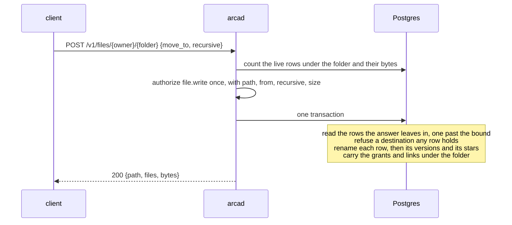

# Moving a folder

## Overview

### Scope

`move_to` takes `recursive` the way `copy_to` does. With
`"recursive": true` the source of the `POST` is the folder at the path,
and every live object under it moves to the same path below `move_to`,
in one call and one database transaction. No route, no action, no table
and no migration is added. [[028-one-tree]] left this out ("a move stays
one object"); this spec adds it.

### Problem

A client that renames a folder today moves each object under it with a
request of its own. A folder of a thousand files is a thousand round
trips, each asked and logged by itself, and a failure halfway leaves
the folder split between two paths with nothing to say which half is
where. A folder copy already runs in one call; a rename, which needs no
byte copied at all, cannot.

## Design

### A folder move is a rename of rows

A bucket key derives from an object id and never from a path
([[003-object-store]], key derivation: `<ARCA_BUCKET_PREFIX><shard>/<object id>`,
built by `object.ID.Key`; [[001-architecture]] invariant 8). Every row
under the folder keeps its id, its object id, its size, its checksum and
its creation time, and changes its path. The bucket is not called, the
space's usage does not move, and nothing is copied. Migration
`0006_one_tree.up.sql` of [[028-one-tree]] moved every workspace into a
folder by the same rename.

### The request

```
POST /v1/files/{owner}/{path...}
{"move_to": "files/archive/2026", "recursive": true}
```

`path` names a folder: every object whose path starts with `path/`, and
never the object at exactly `path`, as for the folder delete and the
copy of [[028-one-tree]]. Each object under it moves to `move_to/` and
the rest of its path: `files/notes/deep/b.md` moves to
`files/archive/2026/deep/b.md`.

Without `recursive` a move is one object, as [[005-files]] has it.

### The question

One `file.write`, with the destination as `path`, the source as `from`,
`recursive: true`, and `size` the sum of the live bytes under the folder,
counted before the answer and so before any omission. It carries no
`id` and no `copy`: a question that carries `from` without `copy` is a
move ([[006-identity]]). An authorizer that does not read `recursive`
answers it as the move of one path, which is never wider than what was
asked. `grant` is the lower of the caller's rungs on the two paths, as
on every question with `from`.

### What moves, and what stays

| | Moves | Stays |
|---|---|---|
| Objects | every live object under the folder that the answer's `limits.omit` covers at neither end | a trashed object, the object at the folder's own path, and an object left out by `limits.omit` |
| Versions | the history of each moved object, with it | the history of what stays |
| Stars | a star on a moved object follows it; a subject that had starred the destination path keeps one star, as a move of one object leaves | stars on what stays |
| Grants and links | a grant or a link whose prefix is the folder or under it follows to the same prefix below `move_to` | one whose prefix is at, under or above a subtree `limits.omit` covers, at either end; and one whose prefix is the path of an object that stays (a trashed one, or the object at the folder's own path), which goes on naming that object |
| Publicity | a public object stays public: publicity is a setting on the bucket key ([[008-shares-and-links]]), and the key does not change | |
| Upload sessions | | a session open under the folder is left alone. One that completes later writes its object at the session's path, by the answer it gets then, as under a folder delete |

A grant follows the folder for the reason [[005-files]] carries an
exact-path grant with a moved object: left behind on a path that is now
free, it would cover the next object written there, which its owner
never shared. A grant on an ancestor of the folder covers a subtree and
stays where it is, as on the move of one object.

A trashed object stays at its path with its history. It is in the trash
by itself and is restored to the path it was trashed from, as each
object under a folder delete is.

### Refusals

Checked in this order. Nothing is moved on any of them.

| Request | Answer | `fields` |
|---|---|---|
| `path` is `files`, the root of the tree | `400` `invalid_path` | `path` |
| `move_to` is not a path under `files/` | `400` `invalid_path` or `unknown_plane` | `move_to` |
| `move_to` is the folder itself | `400` `invalid_field` | `move_to` |
| `move_to` is inside the folder | `400` `invalid_field` | `move_to` |
| nothing live under the folder | `404` `not_found` | |
| the authorizer refuses | `403` `forbidden` on the caller's own space, `404` `not_found` on another's ([[006-identity]]) | |
| more than `files.MaxCopyObjects` objects | `422` `too_many_objects`; the caller moves the folder's subfolders | |
| every object under the folder is left out by `limits.omit` | `404` `not_found`, as a folder with nothing under it | |
| a row, live or trashed, holds a destination path | `409` `path_taken`, naming the first such path | |
| an object read for the move changed before it was renamed | `412` `precondition_failed`; the caller retries | |
| `recursive` with `restore_version`, or with no operation | `400` `invalid_field` | `recursive` |

A destination is taken by a trashed row too, because a path holds one
row ([[004-metadata-store]] `UNIQUE (owner, path)`) and the move of one
object is `path_taken` onto a trashed path already. A destination held
by an object this move would itself move away is taken as well: the
destination may be an ancestor of the folder (`files/notes/deep` moved
to `files/notes`), and an object at `files/notes/deep/x` holds the path
`files/notes/deep/deep/x` would move to. Refusing it keeps the answer
the same whatever order the rows are renamed in.

### The bound

`files.MaxCopyObjects`, 10,000 objects in one call, the bound of the
copy, and its refusal `422` `too_many_objects`. The rows are read in one
page of one past the bound, with the source end of `limits.omit` applied
in the statement; a page past the bound is refused before any row
changes, whatever the destination end of the omission would leave out
of it. The same rule holds for the copy.

### Leaving subtrees out

The answer's `limits.omit` shapes the move as it shapes the copy
([[028-one-tree]]): an object is not moved when an entry covers its
source path or its destination path, and `files` and `bytes` leave it
out. An omitted subtree is neither moved nor written into, and a
destination under one is never checked, so a `path_taken` names no path
the caller may not enumerate.

### The transaction



The rows are renamed only where they are still live at the path that was
read, so an object deleted or moved by another request in between is a
count short and the transaction is refused as `412`. A row written at a
destination between the check and the rename is a unique violation and
`409`. The bucket is not called at any step, and the usage ledger is not
touched.

### The answer and the event

`200` `{"path": "<move_to>", "files": <n>, "bytes": <b>}`, the shape of a
folder copy's answer, where `files` is the objects moved and `bytes`
their sizes.

One `move` event at the destination, appended after the commit, with
detail `{"from": "<folder>", "recursive": true, "files": <n>,
"bytes": <b>}`. The move of one object keeps its detail `{"from"}`.
The tail under `limits.omit` reads both ends of the event, as it does
for every move.

### Compatibility

| Who | What changes for them |
|---|---|
| A client that sent `{"move_to", "recursive": true}` | it was `400` `invalid_field` and is now a folder move |
| A reader of the `too_many_objects` sentence | it names a copy or a move: "The folder holds more objects than one copy or move accepts." |
| An authorizer endpoint | it may be asked a move that carries `recursive: true` and a `size` that is a sum |
| The previous release's conformance suite | its `case028FolderCopy` asserts the `400` above, and reads this release as a break ([[024-conformance-against-a-published-release]]). The module is at v0, so the release moves the minor version and the changelog names the change |

### Not in this spec

- Moving a folder between two spaces.
- Moving the trashed objects under a folder with it.
- Moving an open upload session's path.
- A folder move past the bound, which would need a job with a state of
  its own, as for the copy.
- A conformance case for another installation to run.

## Acceptance criteria

| # | Criterion | Proved by | State |
|---|---|---|---|
| 1 | A folder move renames every live object under the folder to the same path below `move_to`, keeping each row's id, object id, size and checksum, makes no bucket call and leaves the usage as it was | | |
| 2 | Versions and stars of each moved object follow it; a grant and a link under the folder follow it; a grant on an ancestor stays | | |
| 3 | A trashed object, the object at the folder's own path and a sibling whose name begins with the folder's stay where they are, with their history and an exact-path grant | | |
| 4 | A destination a live or a trashed row holds, an object this move would move away included, is `path_taken` and nothing moves | | |
| 5 | `move_to` equal to the folder or inside it is `invalid_field` on `move_to`; the plane root is `invalid_path`; nothing under the folder is `not_found` | | |
| 6 | The move asks one `file.write` with `path`, `from`, `recursive: true` and the sum as `size`, and no `id` and no `copy`; a refusal is the caller's own answer on its space and `not_found` on another's | | |
| 7 | An object whose source or destination `limits.omit` covers is neither moved nor written into, a grant at, under or above it stays, and the counts leave it out | | |
| 8 | A folder past `MaxCopyObjects` is `too_many_objects` before any row changes, for a move and for a copy, whatever the destination omission leaves out | | |
| 9 | An object deleted or renamed between the read and the rename refuses the move as `precondition_failed`, and every store failure is `storage_unavailable` with nothing moved | | |
| 10 | One `move` event at the destination carries `from`, `recursive: true`, `files` and `bytes` | | |
| 11 | The statements rename in Postgres what the handler asks, under an omission and at a destination that is an ancestor of the folder | | |
| 12 | `arcad` as a process moves a folder against the real stores: same object ids and keys, the bytes read at the new paths, the history at a new path, usage unchanged, a second move onto the destination refused | | |
| 13 | The `POST` row of the document names the folder move, and the committed document is current | | |
