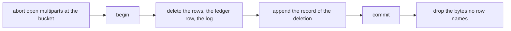

# Space delete

## Overview

An operator that closes an account or deletes an organization has to
delete what the space holds. Nothing in Arca did: a trashed object leaves
at the end of its retention, a purge is one object, and a folder delete
is one folder of one live space. A space as a whole had no route.

This spec adds one, `DELETE /v1/admin/spaces/{owner}`, and the action it
asks, `space.delete`. It removes everything the owner's space holds, in
the order that keeps the two stores honest, and it is safe to repeat.

### The action

`space.delete` is its own action of kind `Space`, not a use of
`space.admin`. That action also reads every space's overview and restores
across owners ([[012-administration]]), and the caller that closes
accounts needs neither power. The two are separate rows of
[[006-identity]]'s table, so an authorizer can allow one caller the
deletion and no more.

The owner policy answers `space.delete` as it answers `space.admin`: allow
a subject listed in `ARCA_ADMIN_SUBJECTS`, deny everyone else, the
space's own owner included. No grant reaches it.

## Design

### The route

`DELETE /v1/admin/spaces/{owner}` asks `space.delete` on the `Space` of
`{owner}` before it acts. `{owner}` is a full subject, `<issuer>|<sub>`,
URL-encoded. It is refused with `400 invalid_field` and `fields: ["owner"]`
before anything is asked when it is the alias `me`, has no issuer or no
sub half, is over the bound of a subject column, or holds a character a
subject cannot carry. The alias is refused because a caller that wipes a
space by an alias wipes its own by a slip.

The answer is `200`:

```json
{"owner": "https://issuer.example|9ab3", "status": "deleted",
 "counts": {"files": 12, "trashed": 1, "versions": 5, "objects": 14,
            "stars": 2, "shares": 1, "links": 0,
            "stars_held": 3, "shares_held": 2,
            "uploads": 0, "events": 40, "usage": 1, "subject": 1}}
```

`files` and `trashed` are the live and the trashed paths, `versions` the
superseded contents, `objects` the bucket objects whose bytes were
dropped. `stars`, `shares` and `links` are what the space carries:
stars on its paths, grants to subjects, and link or public grants.
`stars_held` and `shares_held` are what the owner held on other spaces
as the one who starred and as the grantee. `uploads` is the open upload
sessions, `events` the log rows, and `usage` and `subject` are 1 when the
ledger row and the directory entry existed.

A build that binds no deletion answers `501 not_implemented`.

### What goes

Every statement names the owner in SQL: the `owner` column of `files`,
`file_versions`, `shares`, `stars`, `upload_sessions`, `space_usage` and
`events`, the `subject` column of `stars` and `subjects`, and the
`grantee` column of `shares`. No row is listed and then deleted by a
broader filter. Workspaces are not on the list because
[[028-one-tree]] removed their tables.

The directory entry (`subjects`) holds the display name a token carried,
so it goes with the rest.

### The order



1. Open multiparts are aborted at the bucket first. A session row is the
   only durable pointer to a multipart's parts ([[007-uploads]]), so a
   row deleted ahead of a failed abort strands them. A failed abort fails
   the call with the space untouched, and the caller repeats it.
2. The rows go in one transaction: files and versions, stars and grants
   both ways, upload sessions, the ledger row, the directory entry, and
   the space's log. The ledger row is deleted, not released, so no
   statement writes it back.
3. The record of the deletion is appended last inside the same
   transaction ([[021-transactional-audit-events]]), so the log cannot
   miss a deletion and cannot hold one that rolled back. It is the one
   row a space keeps: the log's delete spares its own action, so a
   repeat does not remove the record of the first call, and the
   reconciler's log retention removes it with the rest of the tail. The
   event is `space_delete`, with the owner, the caller as the actor, and
   the counts as the detail. It holds no path and no file name.
4. The bytes go after the commit (invariant 1 of
   [[001-architecture]]).

### The bytes

An object id is generated per write and is not a content hash, so two
spaces never share bytes by dedup. Rows can still share an id: a
superseded content brought forward, and a version row beside the file row
of the same object. The deletion therefore asks the one statement of
[[010-events-and-reaper]] that decides whether bytes may go,
`store.ObjectReferenced`, for each distinct object the removed rows
named, after the commit, and deletes only those no remaining row
references, in batches, the way the reaper's trash purge does.

A bucket failure or a failed reference read is logged with the owner and
the count, and the call still answers: the rows are gone, so a repeat has
nothing to retry. The object is then one no row names, which pass 1 of
the reconciler removes on a later run. Bytes are therefore delayed by a
failure and never lost, as long as the reconciler runs.

### Idempotence

A second call, and a call for an owner that never had a space, answer
`200` with zero in every count and append no event. The only row a
deletion leaves is the record of the first one.

### Not in this spec

Calling the route is the caller's. The events other spaces hold with this
owner as their actor are another space's log and age out with it. A space
with millions of rows deletes in one transaction; a batching path is
added when a measured space needs one.

## Acceptance criteria

| # | Criterion | Proved by |
|---|---|---|
| 1 | The vocabulary is sixteen actions and `space.delete` is a `Space` action; no grant reaches it and the owner policy admits only a listed administrator | `authorizer` `TestVocabularyMatchesSpec006`; `internal/auth` `TestTheLadderMatchesSpec006` |
| 2 | The route asks `space.delete` on the Space of the owner before it acts; a denied caller gets `403` and nothing is deleted; a caller refused `space.delete` and allowed `space.admin` deletes nothing; the space's own owner is refused under the owner policy | `internal/admin` `TestADeletionAsksSpaceDeleteOnThatSpaceAndAnswersTheCounts`, `TestADeletionIsRefusedForACallerTheAuthorizerDeniesBeforeItActs`, `TestAnAdministratorOfOnlyTheOtherActionDeletesNothing`, `TestTheOwnerOfASpaceCannotDeleteItUnderTheOwnerPolicy` |
| 3 | A malformed owner, the alias included, is `400 invalid_field` naming `owner`, before the authorizer or the seam is reached; an unbound build is `501` | `internal/admin` `TestAMalformedOwnerIsRefusedBeforeAnythingIsAsked`, `TestADeletionWithNoSeamBoundIsNotImplemented` |
| 4 | Every row of the owner goes and no other owner's does: files, versions, trash, stars, grants and links on the space, the owner's stars and grants on other spaces, sessions, ledger, directory entry, log; the counts equal a direct count of the fixtures; the other space is whole | `internal/store` `TestStoreEraseDeletesOneSpaceAndNothingElse` against Postgres |
| 5 | Bytes go after the commit and only when no remaining row names the object; a failed byte delete or reference read is logged and does not fail the call; a failed commit or append keeps every byte | `internal/erasure` `TestAnErasureDropsTheBytesNoRemainingRowNames`, `TestABucketThatWillNotDeleteIsLoggedAndTheErasureStillAnswers`, `TestAnObjectWhoseReferencesCannotBeReadIsKeptForTheReconciler`, `TestACommitThatFailsKeepsTheBytes`, `TestAnAppendThatFailsFailsTheTransactionAndKeepsTheBytes` |
| 6 | An open multipart is aborted at the bucket before any row goes, and a failed abort leaves the space whole | `internal/erasure` `TestAnOpenUploadIsAbortedBeforeAnyRowGoes` |
| 7 | One `space_delete` event is appended last in the transaction with the counts and no path, survives a repeat, and is the only row the space keeps; a space that held nothing records none | `internal/erasure` `TestTheRecordOfTheDeletionIsAppendedInTheTransactionAndNamesNoPath`, `TestASpaceThatHeldNothingRecordsNothingAndTouchesNoBytes`; `internal/events` `TestEventDetailIsMetadataOnly`; `internal/store` `TestStoreEraseKeepsTheRecordOfAnEarlierDeletion` |
| 8 | A repeat and a deletion of an owner that never had a space answer zero counts | `internal/store` `TestStoreEraseOfNothingCountsNothing`; `test/conformance` `case032SpaceDelete` |
| 9 | An installation's deletion is held end to end: a deleted space reads as missing, its log is the one record, the ordinary caller deletes nothing | `test/conformance` `case032SpaceDelete` |
